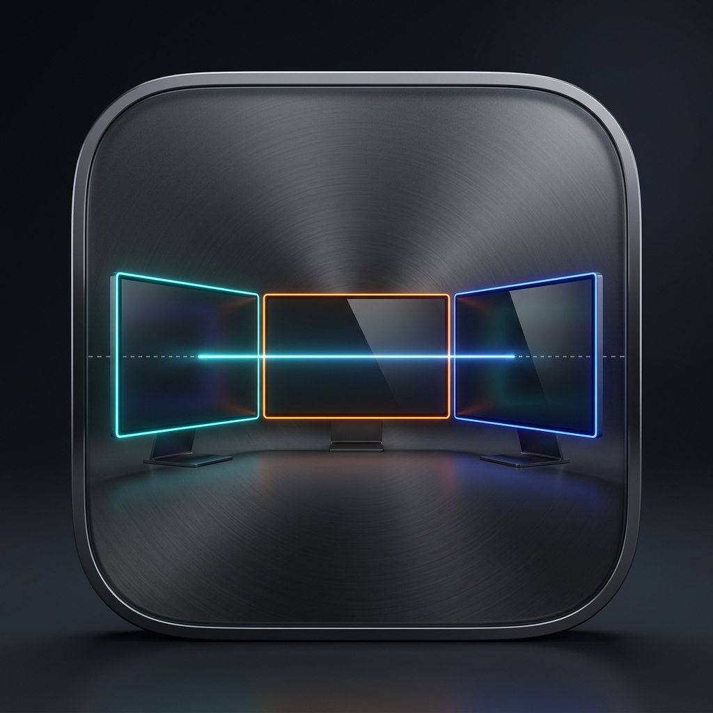

<p align="center">
  
</p>

# DisplayMaster

DisplayMaster is a high-performance, native macOS display manager designed specifically for Apple Silicon MacBooks, external monitors (such as HDMI and DisplayPort screens), and iPad Sidecar setups.

Built 100% in pure Swift, SwiftUI, AppKit, CoreGraphics, and ColorSync. It contains zero Electron overhead, starts instantly, and interacts directly with macOS display subsystems.

---

## Key Features

1. **Smart Alignment Guides in Spatial Arrangement**
   - Interactive 2D workspace to drag and arrange physical displays with zero jitter.
   - Professional smart guides (Figma / Photoshop style) that detect Center Y, Top Edge, Bottom Edge, and touching side edges.
   - High-visibility dashed guide lines with magnetic snapping and smooth breakaway.
   - Equalize Visual Heights mode to inspect alignment across disparate screen sizes.
   - One-click arrangement presets including **MacBook Center Wings** (iPad Left, Zebronics Right).

2. **Seamless Cursor Crossing (Dead Wall Fix)**
   - Eliminates invisible borders between different-sized screens (e.g. MacBook Air 1,050pt vs iPad Pro 970pt).
   - Powered by a background `CGEventTap` that translates cursor crossing coordinates mathematically.
   - **Proportional Mode:** Top matches top, bottom matches bottom, and middle matches middle. Crossing from the dead bottom or dead top of the MacBook slides effortlessly into the iPad Pro.
   - **Edge Slide Mode:** Clamps cursor to the nearest active pixel on adjacent screens.

3. **Hardware Recognition Engine (100% Real Live Data)**
   - Automatically identifies built-in Liquid Retina panels, external HDMI/DP monitors (including 100Hz Zebronics), and iPad Pro Sidecar displays.
   - Allows setting custom aliases/nicknames that persist in `UserDefaults` linked to each monitor's hardware UUID.

4. **Add & Connect Display Hub**
   - High-speed USB-C cable setup for iPad Pro (uncompressed data, charging, lowest latency).
   - Wireless Sidecar and AirPlay 2 peer-to-peer AWDL integration.
   - External HDMI / DisplayPort detection card.

5. **Per-Monitor Resolution & Refresh Rate Tuning**
   - Full enumeration of available hardware display modes via `CGDisplayCopyAllDisplayModes`.
   - Independent control over logical resolution (including HiDPI Retina modes) and physical refresh rates (60 Hz, 75 Hz, 100 Hz, 120 Hz).

6. **Native ColorSync Color Profile Selector**
   - Switches standard industry color profiles directly at the macOS hardware level using `ColorSyncDeviceSetCustomProfiles`.
   - Supports Display P3, Adobe RGB (1998), sRGB IEC61966-2.1, Rec. ITU-R BT.709-5, Rec. ITU-R BT.2020-1, and factory calibrated profiles.
   - One-click restore to hardware factory profile.

7. **Screen Identifier Overlay**
   - Floating translucent HUD overlay that flashes on the selected screen to verify which physical monitor corresponds to each system ID.

8. **Dynamic Hotplug Detection**
   - Debounced subscription to `NSApplication.didChangeScreenParametersNotification` to update immediately whenever external displays or iPad Sidecar sessions connect or disconnect.

---

## macOS Display Subsystems & Architecture Research

### 1. Hardware Video Output on Apple Silicon MacBook Air

- **Display Coprocessor (DCP) & GPU Scan-Out:** Apple Silicon SOCs integrate a dedicated Display Coprocessor that handles frame scan-out, compositing, and timing directly from unified memory.
- **M1 and M2 MacBook Air:** The hardware display engine contains two display heads. One head is permanently assigned to the internal embedded DisplayPort (eDP) Liquid Retina panel. The second head drives one external monitor up to 6K @ 60Hz over USB-C / Thunderbolt.
- **M3 MacBook Air:** Supports up to two external displays simultaneously when the laptop lid is closed (Clamshell mode), as the internal display pipe is re-routed to the secondary external port.

### 2. External Monitors (HDMI, DisplayPort, DDC/CI)

- **Video Signaling:** macOS outputs DisplayPort 1.4 Alternate Mode over USB-C. USB-C to HDMI adapters utilize an active LSPCon (Level Shifter and Protocol Converter) to translate the DP stream into HDMI TMDS or FRL signals.
- **EDID Handshake:** During connection, macOS reads the Extended Display Identification Data block via the I2C bus to determine resolutions and timing parameters (such as 100Hz refresh rate support on Zebronics monitors).
- **DDC/CI Control:** Hardware communication over I2C allows utilities to send MCCS (Monitor Control Command Set) commands directly to the monitor microcontroller for brightness and contrast adjustment.

### 3. iPad Pro & Wireless Display Technologies

- **Apple Sidecar:**
  - Transport operates over high-speed USB-C cable or wireless peer-to-peer Apple Wireless Direct Link (AWDL) with Bluetooth Low Energy discovery.
  - The macOS WindowServer creates an offscreen framebuffer, compressed in real time using VideoToolbox hardware H.264/HEVC encoding (sub-20ms latency).
  - Sidecar displays register as full `CGDirectDisplayID` instances in CoreGraphics, supporting standard coordinate arrangement and scaling.
  - **Why Sidecar is capped at 60Hz:** Despite iPad Pro hardware having a 120Hz ProMotion panel, Apple hardcodes the Sidecar virtual display driver and VideoToolbox encoding profile to 60.00Hz. This design bounds compression latency, limits thermal and battery drain on both devices, and ensures compatibility across older models.
- **Universal Control:** Shares keyboard and cursor input across devices without transmitting video framebuffers. In Universal Control, the iPad Pro continues to render its native iPadOS UI at full 120Hz ProMotion.

---

## System Requirements

- macOS 14.0 (Sonoma) or macOS 15.0+ (Sequoia)
- Apple Silicon (M1, M2, M3, M4) or Intel Mac
- Swift 6.0+ toolchain (Xcode or Command Line Tools)

---

## Building and Running

### Build Release App Bundle

To compile the release binary and generate `DisplayMaster.app`:

```bash
chmod +x scripts/build-app.sh
./scripts/build-app.sh
```

### Launch the App

```bash
open DisplayMaster.app
```

Or run directly via Swift Package Manager during development:

```bash
swift run DisplayMaster
```

---

## Project Structure

```
├── Package.swift                          # Swift Package configuration
├── LICENSE                                # MIT License
├── README.md                              # Technical documentation
├── Resources/
│   ├── AppIcon.icns                       # Native macOS 1024x1024 app icon
│   └── AppIcon.png                        # High-res icon asset
├── scripts/
│   ├── build-app.sh                       # Release build and .app packager
│   └── generate-icns.sh                   # Iconset and .icns converter
└── Sources/
    ├── DisplayMasterApp.swift             # SwiftUI application entry point
    ├── Models/
    │   └── DisplayInfo.swift              # Display, mode, and color profile models
    ├── Services/
    │   ├── DisplayManager.swift           # CoreGraphics & ColorSync hardware service
    │   ├── CursorBridgeService.swift      # Seamless cursor edge crossing engine (Dead Wall Fix)
    │   └── SidecarService.swift           # Native iPad Sidecar connection manager
    └── Views/
        ├── MainContentView.swift          # Navigation layout and routing
        ├── ArrangementCanvasView.swift    # Interactive spatial canvas with Smart Alignment Guides
        ├── CursorCrossingView.swift       # Dead Wall Fix configuration and diagnostics
        ├── AddDisplaySheet.swift          # USB & Wireless Add Display modal
        ├── DisplayInspectorView.swift      # Resolution, refresh rate, and color tuner
        ├── ArchitectureResearchView.swift # In-app technical reference
        └── ScreenIdentifierOverlay.swift  # Floating HUD screen identifier
```

---

## License

This project is licensed under the MIT License.
